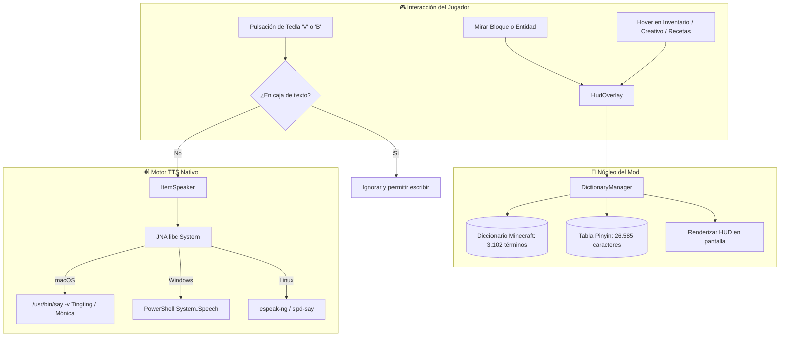

<div align="center">

# 🇨🇳 Pinyin Speaker (拼音助手) 🇪🇸

**Aprende Chino Mandarín y Español de forma 100% inmersiva mientras juegas a Minecraft.**  
*Learn Mandarin Chinese & Spanish effortlessly through real-time gameplay, HUD overlays, and zero-latency native TTS.*

[](https://www.minecraft.net/)
[](https://fabricmc.net/)
[](https://adoptium.net/)
[](#-requisitos-del-sistema--compatibilidad)
[](LICENSE)

</div>

---

## 🎯 Objetivo del Mod / Mission

El aprendizaje tradicional de idiomas a menudo adolece de falta de contexto y repetición aburrida. **Pinyin Speaker** transforma Minecraft en un aula viva e inmersiva:

- **Comprensión contextual inmediata**: Cada bloque que miras, cada criatura con la que interactúas y cada objeto en tus cofres o inventario se convierte en una oportunidad de aprendizaje visual y auditivo.
- **Pronunciación nativa real**: Escucha la entonación tonal exacta del chino mandarín y la pronunciación fluida en español con una sola tecla.
- **Sin distracciones ni fuentes rotas**: Diseñado desde cero para ser **100% Plug-and-Play**, sin necesidad de resource packs externos que descoloquen la tipografía de Minecraft ni ralenticen el juego.

---

## ✨ Características Principales / Core Features

### 1. 🖥️ Indicador HUD Flotante (Top-Center HUD)
Al apuntar con la mira a cualquier bloque o entidad, o al sostener un objeto en la mano, aparece en la parte superior central de la pantalla una elegante ventana flotante con:
- Caracteres chinos (**Hanzi 汉字**)
- Pronunciación fonética con tonos (**Pinyin**)
- Traducción al **Español**

```text
       ┌────────────────────────────────────────────────────────┐
       │             [ 钻石剑 ]   zuàn shí jiàn                 │
       │             Español: Espada de diamante               │
       └────────────────────────────────────────────────────────┘
```

---

### 2. 🎒 Soporte Total en Inventarios y Modo Creativo
El mod se adapta automáticamente a todas las pantallas del juego:
- **Modo Supervivencia**: Inventario del jugador, cofres, hornos, yunques, barriles y mesas de crafteo.
- **Modo Creativo**: Pestañas completas y panel de búsqueda.
- **Libro de Recetas (Recipe Book)**: Pasa el cursor sobre cualquier receta y verás su nombre y pronunciación al instante.
- **Protección Inteligente en Buscadores**: Si estás escribiendo en la barra de búsqueda del creativo o del libro de recetas, pulsar `V` o `B` no activará la voz, permitiéndote escribir con normalidad.

---

### 3. 🔊 Síntesis de Voz Nativa Sin Lag (Zero-Latency TTS)
A diferencia de otros mods que descargan audios lentos por internet con retrasos de varios segundos, **Pinyin Speaker** se comunica directamente con las APIs de voz nativas del sistema operativo:
- **Tecla `V`**: Pronuncia el nombre en **Chino Mandarín** (Voz nativa `Tingting` en macOS, Microsoft SAPI en Windows, eSpeak-NG en Linux).
- **Tecla `B`**: Pronuncia la traducción al **Español** (Voz nativa `Mónica` en macOS, SAPI en Windows, eSpeak-NG en Linux) y muestra un aviso visual en la barra de acción.
- **Corte instantáneo**: Si pulsas varias veces seguidas, la voz anterior se interrumpe de inmediato para pronunciar el nuevo objeto sin solapamientos.

---

### 4. 📦 100% Plug-and-Play (Diccionario Autónomo)
No requiere descargar ni activar ningún Resource Pack. El archivo `.jar` incluye internamente:
- **3.102 términos oficiales** traducidos minuciosamente entre Chino Mandarín, Español e Inglés (todos los bloques, ítems, entidades y biomas de Minecraft 1.21.1).
- **26.585 caracteres chinos fonetizados** en una base de datos ultrarrápida en memoria que asegura que incluso nombres personalizados o criaturas raras tengan su Pinyin con marcas de tono exactas.

---

### 5. 🏷️ Tooltips Informativos Claros
Al pasar el ratón sobre cualquier ítem en cualquier pantalla, se añaden líneas limpias con colores distintivos:

```text
  ┌──────────────────────────────────────────────┐
  │ 钻石剑                                       │
  │ [汉字] 钻石剑  zuàn shí jiàn                │
  │ [Español] Espada de diamante                 │
  │                                              │
  │ Daño de ataque: +7                           │
  │ Velocidad de ataque: 1.6                     │
  └──────────────────────────────────────────────┘
```

---

## 🎮 Controles y Uso / Controls

| Tecla | Acción | Dónde funciona |
| :---: | :--- | :--- |
| **`V`** | **Pronunciar en Chino Mandarín** | Mirando al mundo (bloques/mobs/mano) y sobre cualquier ítem en inventarios, creativo y recetas. |
| **`B`** | **Pronunciar en Español** + Notificación | Mirando al mundo y sobre cualquier ítem en cualquier interfaz. |
| **Cursor** | **Hover automático** | Muestra el HUD superior y las etiquetas en el tooltip sin pulsar nada. |

> [!TIP]
> Puedes reasignar las teclas **V** y **B** en cualquier momento desde el menú estándar del juego:  
> **Opciones ➔ Controles ➔ Asignación de teclas ➔ Pinyin Speaker**.

---

## 💻 Requisitos del Sistema y Compatibilidad

| Requisito | Versión Soportada / Detalles |
| :--- | :--- |
| **Juego** | **Minecraft 1.21.1** |
| **Cargador de Mods** | **Fabric Loader** `0.16.x` o superior (probado en `0.20.1`) |
| **Dependencia obligatoria** | **Fabric API** (`0.116.17+1.21.1` o compatible) |
| **Java** | **Java 21** (la versión estándar incluida en el launcher oficial) |
| **Sistemas Operativos** | **macOS** (Apple Silicon M1/M2/M3/M4 e Intel) — *Voces nativas Tingting / Mónica*<br>**Windows** (10 y 11) — *System.Speech SAPI zh-CN / es-ES*<br>**Linux** (Ubuntu, Arch, Fedora, etc.) — *espeak-ng / espeak / spd-say* |
| **Compatibilidad gráfica** | 100% compatible con **Sodium**, **Iris Shaders**, **ModMenu**, **JEI**, **REI** y otros mods populares de rendimiento. |

---

## 📥 Instalación (Plug and Play)

1. Asegúrate de tener instalado el perfil de **Fabric 1.21.1** en tu launcher de Minecraft.
2. Descarga el mod **`fabric-api`** para Minecraft 1.21.1.
3. Descarga la última versión de **`pinyin-speaker-1.0.0.jar`**.
4. Coloca ambos archivos `.jar` dentro de la carpeta `mods` de Minecraft:
   - **macOS**: `~/Library/Application Support/minecraft/mods/`
   - **Windows**: `%appdata%\.minecraft\mods\`
   - **Linux**: `~/.minecraft/mods/`
5. ¡Inicia el juego y a aprender chino!

---

## 🏗️ Compilación desde el Código Fuente / Building

Si eres desarrollador y deseas compilar el mod tú mismo:

```bash
# 1. Clonar el repositorio
git clone https://github.com/pelayo/pinyin-speaker.git
cd pinyin-speaker

# 2. Compilar con Gradle (requiere Java 21)
./gradlew build

# 3. El archivo .jar generado estará en:
# build/libs/pinyin-speaker-1.0.0.jar
```

---

## 🗺️ Arquitectura Técnica



---

## 📄 Licencia y Términos de Uso

Este proyecto ha sido creado por **Pelayo Garrido** y está protegido bajo la licencia internacional **[Creative Commons Attribution-NonCommercial-ShareAlike 4.0 (CC BY-NC-SA 4.0)](LICENSE)**.

- **Atribución Obligatoria (BY)**: Debes otorgar crédito explícito y visible al autor original (**Pelayo Garrido**) y enlazar a este repositorio oficial. Queda terminantemente prohibido atribuirse la autoría o creación de este mod o de esta idea pedagógica.
- **Uso No Comercial (NC)**: Queda terminantemente prohibido vender, monetizar, cobrar suscripciones o lucrarse con este mod, su código fuente o cualquier trabajo derivado.
- **Compartir Igual (SA)**: Cualquier derivación o modificación debe distribuirse bajo exactamente esta misma licencia.
- **Creadores de Contenido (YouTube / Twitch / TikTok)**: ¡Eres 100% libre de usar este mod en gameplays, directos y series de Minecraft! Solo te pedimos que nombres el mod y enlaces a este repositorio oficial en la descripción de tu contenido.
